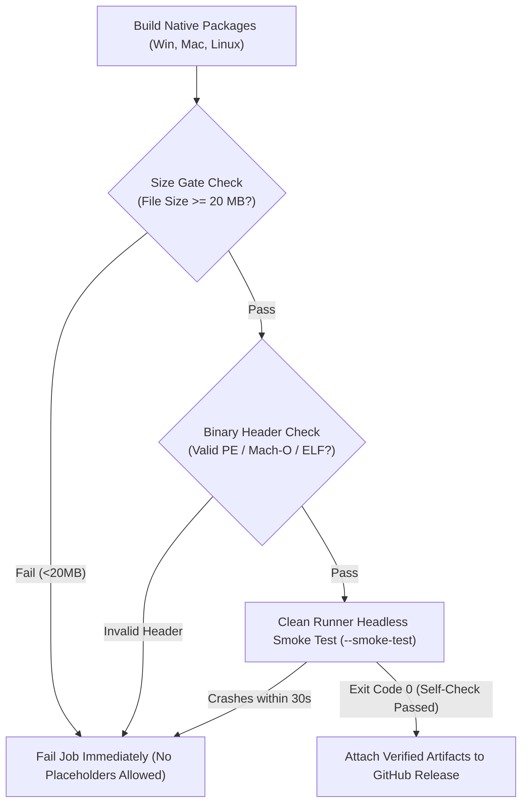

# FLOAT Studio — Build, Packaging, and Release Engineering

**Document Version:** 1.0.0  
**Status:** Authoritative Pipeline Specification  
**Last Updated:** November 2026  
**Target Milestone:** Sprint B Release System Productionization  

---

## 1. Overview & Current Defect Audit

### 1.1. Current Defect in `.github/workflows/release.yml`
During the baseline engineering audit, a critical packaging defect was identified in `.github/workflows/release.yml` (lines 58-62):
```yaml
# DEFECTIVE CODE IDENTIFIED IN BASELINE:
- name: Package Desktop Artifacts
  run: |
    mkdir -p dist/release
    echo "FLOAT Studio Desktop Release Placeholder" > dist/release/FLOAT-Setup-x64.exe
    echo "FLOAT Studio Desktop Release Placeholder" > dist/release/FLOAT-darwin-arm64.dmg
    echo "FLOAT Studio Desktop Release Placeholder" > dist/release/float-desktop_amd64.deb
```
**Impact:** The existing release workflow generates 42-byte text files instead of actual compiled desktop binaries. Any release published with this workflow produces unexecutable files.

### 1.2. Sprint B Remediation Mandate
In Sprint B, this pipeline is completely replaced with genuine native build and packaging steps producing verified binaries exceeding 20 MB with valid OS executable headers (PE on Windows, Mach-O on macOS, ELF on Linux).

---

## 2. Platform Packaging Specifications

### 2.1. Windows (x64)
- **Artifacts:**
  1. `FLOAT-Setup-x64.exe` (Inno Setup or NSIS Installer)
  2. `FLOAT-win32-x64-portable.zip` (Portable Archive)
- **Prerequisites:**
  - Inno Setup 6 (`iscc`) or NSIS 3 (`makensis`).
  - Visual C++ 2015-2022 Redistributable (`vc_redist.x64.exe`) bundled into installer payload.
- **Packaging Steps:**
  1. Compile Code-OSS client and Float workbench extensions:
     ```bash
     cd desktop && npm run compile-build
     ```
  2. Minify and bundle Code-OSS Electron shell:
     ```bash
     cd desktop && npm run minify-vscode
     ```
  3. Bundle Float Daemon sidecar binary and precompiled tree-sitter grammars.
  4. Generate Inno Setup installer script linking `FLOAT.exe`, dependencies, registry uninstall entries, and Start Menu shortcuts.
  5. Validate output artifact:
     - File size must exceed 45 MB.
     - Binary header must start with `MZ` (PE format).

---

### 2.2. macOS (Apple Silicon arm64 & Intel x64)
- **Artifacts:**
  1. `FLOAT-darwin-arm64.dmg` & `FLOAT-darwin-x64.dmg` (or universal `FLOAT-darwin-universal.dmg`)
  2. `FLOAT-darwin-arm64.zip`
- **Prerequisites:**
  - macOS runner with Xcode Command Line Tools.
  - `create-dmg` utility.
- **Entitlements & Hardened Runtime:**
  The `.app` bundle must declare hardened-runtime entitlements (`build/darwin/entitlements.plist`):
  - `com.apple.security.cs.allow-jit` (required for V8 execution)
  - `com.apple.security.cs.allow-unsigned-executable-memory`
  - `com.apple.security.cs.disable-library-validation` (for native node-pty and tree-sitter addons)
- **Signing & Notarization:**
  - Build pipeline must succeed **unsigned** in open-source CI when `APPLE_CERTIFICATE` secrets are absent.
  - When secrets are present (`APPLE_ID`, `APPLE_APP_SPECIFIC_PASSWORD`, `APPLE_TEAM_ID`), trigger `codesign` and `xcrun notarytool submit`.
- **Validation:**
  - Artifact size must exceed 50 MB.
  - Header inspection confirms Mach-O binary format.

---

### 2.3. Linux (amd64 / x86_64)
- **Artifacts:**
  1. `float-desktop_amd64.deb` (Debian/Ubuntu Package)
  2. `FLOAT-linux-x64.tar.gz` (Standalone Archive)
- **Package Metadata & Dependencies:**
  The Debian package control file must declare exact runtime dependencies:
  ```control
  Package: float-studio
  Version: 1.0.0
  Section: devel
  Priority: optional
  Architecture: amd64
  Depends: libgtk-3-0, libnss3, libasound2, libxss1, libx11-xcb1, libsecret-1-0, libc6 (>= 2.31)
  Maintainer: FLOAT Studio Engineering <engineering@float.dev>
  Description: AI-Native Code-OSS Integrated Development Environment
  ```
- **AppArmor Profile (Ubuntu 24.04+ Requirement):**
  Ubuntu 24.04 restricts unprivileged user namespaces. FLOAT installs an AppArmor profile in `/etc/apparmor.d/float-studio`:
  ```apparmor
  abi <abi/4.0>,
  include <tunables/global>

  profile float-studio /opt/FLOAT/float {
    include <abstractions/base>
    include <abstractions/nameservice>
    include <abstractions/gui>
    
    userns,
    /opt/FLOAT/** mr,
    /dev/shm/* mrw,
    owner /tmp/** rw,
    owner @{HOME}/.config/FLOAT/** rw,
  }
  ```
- **Desktop Entry:**
  Installs `/usr/share/applications/float-studio.desktop` with `Categories=Development;IDE;`.
- **Validation:**
  - `.deb` must unpack cleanly via `dpkg -i`.
  - Artifact size must exceed 45 MB.
  - ELF 64-bit LSB executable format validated.

---

## 3. Artifact Validation & Smoke Gates

Every release workflow must enforce strict gates before artifacts can be attached to GitHub Releases:



### Self-Check Headless Flag (`--smoke-test`)
When launched with `--smoke-test`, the application:
1. Spawns the Electron main window in headless mode (`--enable-logging --headless=new`).
2. Loads a temporary scratch workspace.
3. Initializes the Code-OSS workbench and confirms that Monaco, Float Chat, and Float Composer views successfully mount.
4. Contacts the Float Daemon sidecar over IPC and receives a successful ping response.
5. Sends one mock test message through the model client to verify the AI stream path.
6. Automatically exits with **code 0** on success, or non-zero code on failure/crash.

---

## 4. Local Build Commands Quick Reference

### Web Companion:
```bash
npm run build:web       # Output: dist/
```

### Express Server:
```bash
npm run build:server    # Output: dist/server.cjs & dist/server.js
```

### Full Web & Server Distribution:
```bash
npm run build           # Output: dist/
```

### Desktop Extensions & Daemon Worker:
```bash
npm run build:desktop   # Output: extension VSIX and worker JS bundles
```
