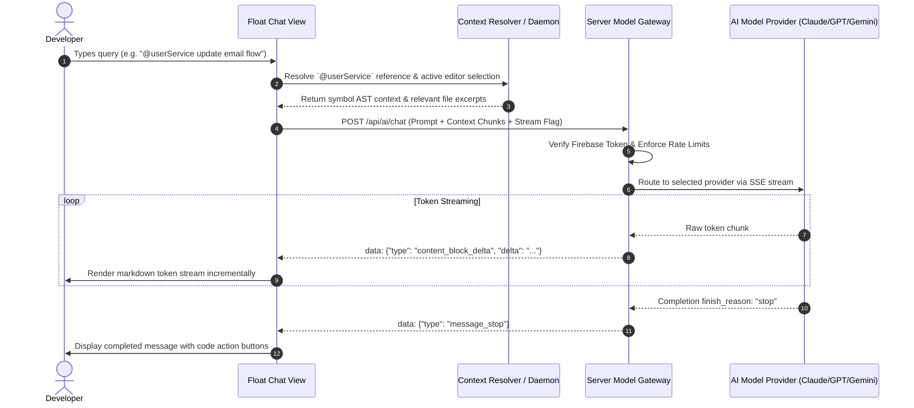
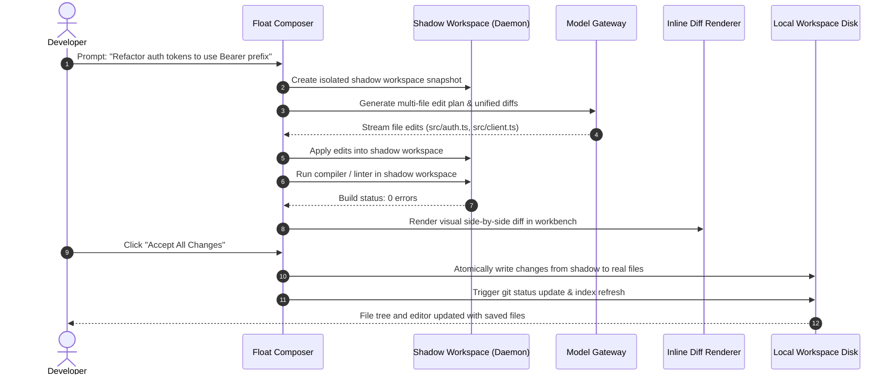

# FLOAT Studio — Current System Architecture

**Document Version:** 1.0.0  
**Status:** Living Engineering Reference  
**Last Updated:** November 2026  
**Primary Baseline:** Code-OSS v1.99.3 + Float Workbench Extensions + Node.js 22 Express Services  

---

## 1. Executive Summary & Dual-Product Model

FLOAT Studio is an AI-native integrated development environment engineered to deliver developer capabilities comparable to Cursor. The repository maintains a dual-target architecture:

1. **Desktop IDE (Primary Product):**
   - Built on a Code-OSS (v1.99.3) / Electron shell.
   - Core AI experiences are implemented directly as native workbench contributions inside `desktop/src/vs/workbench/contrib/float/`.
   - Communicates with a high-performance local sidecar service (**Float Daemon**) via IPC/UNIX sockets for AST parsing, multi-file semantic search, and speculative next-action caching.
2. **Web IDE & Companion Portal (Cloud & Account Surface):**
   - Built with React 19, Vite, Tailwind CSS, Monaco Editor (`@monaco-editor/react`), and Zustand.
   - Serves as the cloud workspace browser, account/subscription management interface, and lightweight remote editor.
   - Communicates with the Express API server over REST and Server-Sent Events (SSE).
3. **Backend API & Multi-Provider Model Gateway:**
   - A unified Express.js service hosted in Node.js 22 (`server.ts` / `src/server/app.ts`).
   - Normalizes requests across Anthropic Claude, OpenAI GPT-4o, and Google Gemini models.
   - Manages server-side Git/GitHub operations, Firebase Authentication verification, and Firestore cloud persistence.

---

## 2. High-Level System Architecture Diagram

```mermaid
flowchart TB
    subgraph DesktopClient["FLOAT Desktop Application (Code-OSS / Electron)"]
        ElectronMain["Electron Main Process (main.js)"]
        ElectronPreload["Preload Bridge (preload.js)"]
        WorkbenchRenderer["Workbench Renderer (Code-OSS v1.99.3)"]
        
        subgraph FloatWorkbench["Float Workbench Contributions (desktop/src/vs/workbench/contrib/float/)"]
            ChatUI["Float Chat Panel"]
            ComposerUI["Float Composer & Multi-File Diff"]
            InlineDiff["Native Inline Diff Decorator"]
            CursorTab["Predictive Autocomplete / Ghost Text"]
            ContextService["Float Context & Symbol Resolver"]
            DaemonClient["Float Daemon IPC Client"]
        end
    end

    subgraph Sidecar["Float Daemon (Local Background Process)"]
        DaemonServer["Daemon IPC Server (UNIX Socket / Named Pipe)"]
        AstChunker["Tree-Sitter AST Chunker (daemon/src/ast/)"]
        GrammarCatalog["Grammar Parser Catalog (daemon/grammars/)"]
        SemanticIndexer["Workspace Vector & Lexical Indexer"]
        ShadowFS["Shadow Workspace Virtualizer (daemon/src/shadow/)"]
    end

    subgraph WebCompanion["FLOAT Web Companion (React 19 + Monaco)"]
        ReactUI["React UI (src/components/)"]
        Monaco["Monaco Editor"]
        ZustandStores["Zustand State Stores (src/stores/)"]
        ClientGateway["AI Service Client (src/services/aiService.ts)"]
    end

    subgraph BackendServer["FLOAT Backend Services (Node.js 22 / Express)"]
        ExpressApp["Express App (src/server/app.ts)"]
        AuthMiddleware["Firebase Auth Verifier (src/server/middleware/auth.ts)"]
        ModelGateway["Model Gateway & Router (src/server/models/)"]
        GitPrService["Git & GitHub Service (src/server/git/gitPrService.ts)"]
        TerminalManager["Terminal & PTY Manager (src/server/terminal/terminalManager.ts)"]
        Persistence["Firestore / SQLite Storage (src/server/persistence/)"]
    end

    subgraph ExternalServices["External APIs & Services"]
        OpenAI["OpenAI API (GPT-4o, o3-mini)"]
        Anthropic["Anthropic API (Claude 3.5 Sonnet)"]
        Gemini["Google Gemini API (Gemini 2.5 Pro/Flash)"]
        FirebaseAuth["Firebase Authentication"]
        GitHubAPI["GitHub REST API"]
    end

    WorkbenchRenderer --> FloatWorkbench
    FloatWorkbench --> DaemonClient
    DaemonClient <--> |Fast Local IPC| DaemonServer
    DaemonServer --> AstChunker
    DaemonServer --> SemanticIndexer
    DaemonServer --> ShadowFS

    FloatWorkbench --> |HTTP / SSE Streaming| ExpressApp
    ClientGateway --> |HTTP / SSE Streaming| ExpressApp

    ExpressApp --> AuthMiddleware
    AuthMiddleware --> FirebaseAuth
    ExpressApp --> ModelGateway
    ExpressApp --> GitPrService
    ExpressApp --> TerminalManager
    ExpressApp --> Persistence

    ModelGateway --> OpenAI
    ModelGateway --> Anthropic
    ModelGateway --> Gemini
    GitPrService --> GitHubAPI
```

---

## 3. Subsystem Breakdown & Directory Ownership

### 3.1. Desktop Code-OSS Workbench (`desktop/src/vs/workbench/contrib/float/`)
The native desktop IDE extends Code-OSS workbench architecture with modular services registered in the VS Code dependency injection container:
- **`floatChat.contribution.ts` & `floatChatView.ts`**: Sidebar chat container supporting session history, model picker, inline code block syntax highlighting, and `@file`/`@symbol` context chips.
- **`floatComposer.contribution.ts` & `floatComposerView.ts`**: Autonomous multi-file editor providing file plan generation, dry-run diff inspection, and atomic multi-file application.
- **`floatNativeInlineDiff.ts`**: High-performance editor line-level diff renderer providing green additions, red deletions, and inline Accept/Reject buttons without corrupting Monaco line maps.
- **`floatPredictiveAutocomplete.ts`**: Fast inline completion provider leveraging prefix/suffix context, AST call-graph heuristics, and speculative next-edit predictions.
- **`floatDaemonClient.ts`**: Low-latency IPC communication client connecting workbench services to the local Float daemon.
- **`floatShadowWorkspace.ts`**: Virtual workspace filesystem manager allowing agent tools to write, format, and execute tests against modified files before user approval.

### 3.2. Float Daemon (`daemon/`)
The daemon is an isolated Node.js/native process responsible for compute-heavy codebase intelligence:
- **`daemon/src/server.ts`**: IPC transport server supporting UNIX domain sockets (`/tmp/float-daemon.sock`) on Linux/macOS and Named Pipes (`\\.\pipe\float-daemon`) on Windows.
- **`daemon/src/ast/`**: Tree-sitter AST parser generating hierarchical symbol definitions, imports, exports, and call-hierarchy edges.
- **`daemon/grammars/data/*.ts`**: Precompiled grammar catalogs covering TypeScript, JavaScript, Python, Rust, Go, Java, C, C++, Ruby, PHP, and C#.
- **`daemon/src/index/`**: Hybrid indexer combining BM25 lexical token matching with local vector embeddings for sub-50ms codebase search across 100,000+ files.
- **`daemon/src/shadow/`**: Copy-on-write workspace staging directory enabling isolated test execution and validation loops.

### 3.3. Web Companion & React Frontend (`src/`)
The browser-accessible web application mirrors core IDE interfaces:
- **`src/components/`**: Layout panels, chat drawer, composer modal, diff review inspector, terminal viewer, and settings pages.
- **`src/stores/`**: Reactive Zustand stores (`useChatStore`, `useComposerStore`, `useWorkspaceStore`, `useProjectStore`, `useAuthStore`).
- **`src/services/`**: API clients encapsulating SSE streaming, file sync, and project checkpoint management.

### 3.4. Backend API & Multi-Provider Model Gateway (`src/server/`)
The server encapsulates enterprise orchestration and provider resilience:
- **`src/server/models/modelGateway.ts`**: Intelligent request router supporting fallback cascades (e.g., Claude 3.5 Sonnet -> GPT-4o -> Gemini 2.5 Pro).
- **`src/server/middleware/auth.ts`**: Strict Firebase ID token verification. When unauthenticated, stateful endpoints return HTTP 401.
- **`src/server/terminal/terminalManager.ts`**: Pseudoterminal manager (`node-pty`) with command risk analysis, shell process lifecycle management, and optional Docker container confinement.
- **`src/server/git/gitPrService.ts`**: Git branch isolation and GitHub Pull Request integration with automated credential scanning.

---

## 4. End-to-End Data Flows

### 4.1. AI Chat Flow with Context Retrieval & Streaming

### 4.2. Autonomous Composer Multi-File Editing Flow

---

## 5. Architectural Invariants & Production Principles

1. **Strict Credential Containment:**
   Provider API keys (`OPENAI_API_KEY`, `ANTHROPIC_API_KEY`, `GEMINI_API_KEY`) reside solely on the server or in secure native desktop storage (Keychain / DPAPI). They are never emitted in client JavaScript bundles.
2. **Graceful Degradation:**
   If the Float Daemon is stopped or unavailable, the desktop IDE automatically falls back to lightweight in-process lexical search and direct HTTP model routing.
3. **No Unapproved Disk Modifications:**
   Agent-generated code changes are always staged in virtual/shadow workspaces until explicitly reviewed and accepted by the developer.
4. **Platform Isolation:**
   Code-OSS workbench contributions communicate with OS facilities strictly via typed IPC contracts, ensuring compatibility across macOS, Linux, and Windows.
