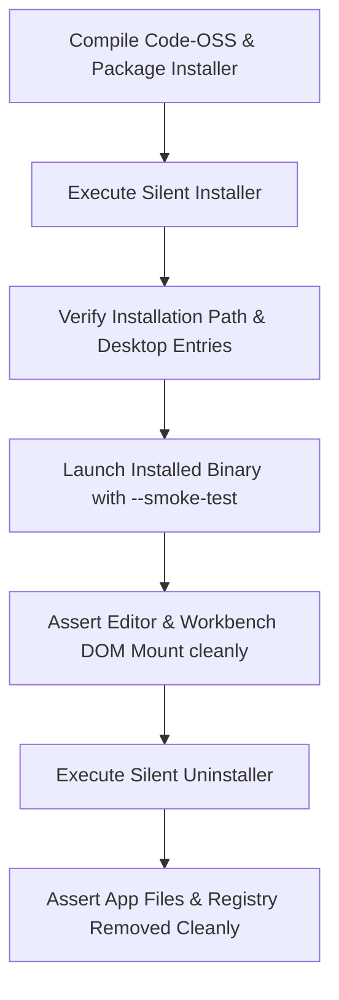

# FLOAT Studio — Native Desktop Packaging & Release Specification

> **Status**: SPECIFICATION & IMPLEMENTATION ROADMAP (Prompt 1.1 Baseline)  
> **Target Release Engineering Phase**: Prompt 2  
> **Application Architecture**: Code-OSS Workbench with Electron Shell  

---

## 1. Problem Statement & Baseline Truth

Prior release automation attempted to generate release packages by:
1. Downloading upstream prebuilt Electron runtimes (`electron-v34.3.2-*.zip`).
2. Copying the Vite-compiled React web client (`dist/`) into `resources/app`.
3. Writing 42-byte text files (`echo "..." > dist/release/*.exe`) as place-holder release assets.
4. Using insecure Electron `BrowserWindow` settings (`nodeIntegration: true`, `contextIsolation: false`, `webSecurity: false`).
5. Asserting envelope size (>= 20 MB) and binary magic bytes without executing installer lifecycles or verifying Code-OSS runtime health.

This approach does **not** package the genuine FLOAT Studio desktop IDE. FLOAT Studio is built upon a Code-OSS foundation with native workbench contributions, language services, and a background daemon. Wrapping a web preview in Electron does not constitute an authentic native IDE release.

Production releases are **fail-closed and blocked** in `.github/workflows/release.yml` until the full native desktop packaging pipeline specified below is implemented in Prompt 2.

---

## 2. Platform-by-Platform Native Packaging Requirements

### 2.1 Windows (x64)

#### Prerequisite Compilation
- Complete TypeScript compilation of the Code-OSS desktop source tree in `desktop/src/` to `desktop/out/`.
- Compilation of native Electron main process, preload scripts, and utility process daemon (`floatDaemonWorkerMain.js`).
- Output executable binary must be named `FLOAT.exe`.

#### Inno Setup Installer (`FLOAT-Setup-x64.exe`)
- **Compiler**: Inno Setup 6 (`ISCC.exe`) running on Windows runner (`windows-latest`).
- **Runtime Bundling**: Microsoft Visual C++ 2015–2022 Redistributable (`vc_redist.x64.exe`), invoked during setup via:
  ```ini
  [Run]
  Filename: "{tmp}\vc_redist.x64.exe"; Parameters: "/install /passive /norestart"; Flags: runascurrentuser waituntilterminated
  Filename: "{app}\FLOAT.exe"; Description: "{cm:LaunchProgram,FLOAT Studio}"; Flags: nowait postinstall skipifsilent
  ```
- **Silent Automation Flags**: Must cleanly support `/VERYSILENT /SUPPRESSMSGBOXES /NORESTART`.
- **System Integration**:
  - Start Menu shortcuts (`{autoprograms}\FLOAT Studio`).
  - Desktop shortcut option (`{autodesktop}\FLOAT Studio`).
  - Add/Remove Programs registry registration with valid version, icon, and uninstaller.
- **Uninstaller Verification**:
  - Generates working `unins000.exe`.
  - Silent uninstall (`unins000.exe /VERYSILENT /NORESTART`) must completely remove application files from `LOCALAPPDATA\Programs\FLOAT Studio`.

#### Portable Bundle (`FLOAT-win32-x64.zip`)
- Self-contained directory containing `FLOAT.exe`, dependencies, native node addons, and license.

---

### 2.2 macOS (arm64 & x64 Universal)

#### Application Bundle Layout (`FLOAT.app`)
- Structure:
  ```
  FLOAT.app/
  └── Contents/
      ├── Info.plist
      ├── MacOS/
      │   └── FLOAT (Mach-O 64-bit universal/arm64 binary)
      ├── Resources/
      │   ├── float.icns
      │   └── app/
      │       ├── package.json
      │       ├── product.json
      │       └── out/ (compiled Code-OSS workbench)
      └── Frameworks/
          ├── Electron Framework.framework
          ├── FLOAT Helper.app
          ├── FLOAT Helper (GPU).app
          ├── FLOAT Helper (Plugin).app
          └── FLOAT Helper (Renderer).app
  ```

#### Security & Hardened Runtime
- **Entitlements**: `entitlements.plist` must specify:
  ```xml
  <key>com.apple.security.cs.allow-jit</key><true/>
  <key>com.apple.security.cs.allow-unsigned-executable-memory</key><true/>
  <key>com.apple.security.cs.disable-library-validation</key><true/>
  ```
- **Codesigning**: Signed via `codesign --deep --force --options runtime --entitlements entitlements.plist --sign "Developer ID Application: ..."`
- **Notarization & Stapling**:
  - Submit using `xcrun notarytool submit ... --keychain-profile ... --wait`.
  - Staple ticket to `.dmg` and `.app` using `xcrun stapler staple ...`.
- **Unsigned Fallback**: When Apple signing secrets are not present in CI (e.g. external PRs), builds must succeed unsigned with explicit developer warnings and documented Gatekeeper bypass procedures (`xattr -cr /Applications/FLOAT.app`).

#### Distribution Artifacts
- Disk image: `FLOAT-arm64.dmg` (Apple UDIF format with Applications drag-and-drop symlink).
- Portable archive: `FLOAT-darwin-arm64.zip`.

---

### 2.3 Linux (amd64)

#### Debian Package (`float-studio_amd64.deb`)
- **Package Architecture**: `amd64`.
- **System Hierarchy**:
  - Application payload: `/usr/share/float-studio/`.
  - Executable symlink: `/usr/bin/float-studio -> /usr/share/float-studio/float-studio`.
  - Desktop Entry: `/usr/share/applications/float-studio.desktop`.
  - AppArmor Profile: `/etc/apparmor.d/float-studio`.
- **Explicit Dependencies (`DEBIAN/control`)**:
  ```control
  Package: float-studio
  Version: 1.0.0
  Section: devel
  Priority: optional
  Architecture: amd64
  Maintainer: FLOAT Studio Team <support@float.dev>
  Depends: libgtk-3-0, libnss3, libasound2 | libasound2t64, libxss1, libx11-xcb1, libsecret-1-0, libc6 (>= 2.31)
  Description: FLOAT Studio — AI-native development environment.
  ```

#### Ubuntu 24.04+ AppArmor Profile
Ubuntu 24.04 restricts unprivileged user namespaces by default (`kernel.apparmor_restrict_unprivileged_userns = 1`), preventing Chromium/Electron sandboxes from spawning without an explicit profile:
```apparmor
# /etc/apparmor.d/float-studio
abi <abi/4.0>,
include <tunables/global>

profile float-studio /usr/share/float-studio/float-studio flags=(unconfined) {
  userns,
  include if exists <local/float-studio>
}
```
- Package `DEBIAN/postinst` must reload AppArmor:
  `apparmor_parser -r -T /etc/apparmor.d/float-studio 2>/dev/null || true`

#### Portable Archive (`FLOAT-linux-x64.tar.gz`)
- Standard gzip tarball containing the root `float-studio` folder with executable permissions (`0755`).

---

## 3. End-to-End Installer Lifecycle Smoke Test Specification

Binary envelope checks (>= 20 MB and magic byte headers) are necessary format filters, but they do **not** verify that the installer actually works.

Prompt 2 must implement real lifecycle smoke tests in GitHub Actions:



### Windows Smoke Test Matrix
1. Run `FLOAT-Setup-x64.exe /VERYSILENT /SUPPRESSMSGBOXES /NORESTART`.
2. Confirm `$env:LOCALAPPDATA\Programs\FLOAT Studio\FLOAT.exe` exists.
3. Confirm Start Menu shortcut `$env:APPDATA\Microsoft\Windows\Start Menu\Programs\FLOAT Studio.lnk` exists.
4. Launch installed `FLOAT.exe --smoke-test --headless`.
5. Verify clean exit code `0` within 30 seconds.
6. Run `unins000.exe /VERYSILENT /NORESTART`.
7. Confirm `$env:LOCALAPPDATA\Programs\FLOAT Studio` directory is removed.

### Linux Smoke Test Matrix (Ubuntu 24.04)
1. Install `.deb`: `sudo dpkg -i dist/release/float-studio_amd64.deb || sudo apt-get install -f -y`.
2. Verify AppArmor profile is active.
3. Launch installed binary under Xvfb **WITHOUT `--no-sandbox`**:
   `xvfb-run --auto-servernum /usr/bin/float-studio --smoke-test --headless`.
4. Verify clean exit code `0`.
5. Remove package: `sudo dpkg -r float-studio`.
6. Verify `/usr/share/float-studio` is removed.

---

## 4. BrowserWindow Security Mandate

Under no circumstances may packaging scripts or desktop wrappers disable Electron platform security controls. Every `BrowserWindow` must strictly configure:
```typescript
webPreferences: {
  nodeIntegration: false,    // Strictly disable direct Node access in renderer
  contextIsolation: true,    // Enforce isolated context boundary
  webSecurity: true,         // Enforce same-origin policy
  sandbox: true              // Enable Chromium renderer sandbox
}
```
Direct access to system resources must exclusively occur across IPC channels mediated by preload scripts and verified IPC protocol handlers.
