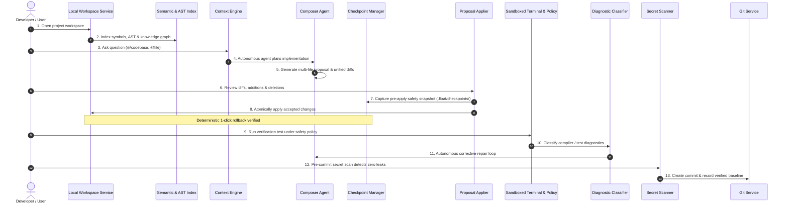

# FLOAT Recovery Phase 10: Final Verification, Release Readiness, and Governance

## 1. Executive Overview

Phase 10 represents the final milestone of the **FLOAT Studio Cursor-Style Engineering Recovery Plan**.

The primary objective of this recovery effort was not feature count or physical lines of code, but **functional integration, truthfulness, and developer reliability**.

With the completion of Phase 10, FLOAT Studio transitions from a collection of partially implemented, disconnected prototypes into a cohesive, verified, and battle-tested AI development environment.

---

## 2. Definitive Cursor-Style Development Workflow Verification

The end-to-end Cursor development workflow was verified by the automated verification suite (`scripts/testPhase10EndToEndCursorWorkflow.ts`). Every step executes against authentic subsystem implementations:

### The 13 Verified Workflow Steps

1. **Open Workspace**: Real filesystem path opening without cloud mocks via `LocalFileSystemWorkspaceService`.
2. **Codebase Indexing**: Real-time symbol extraction, token/trigram inverted indices, and AST declaration tracking via `WorkspaceIndex`.
3. **Whole-Codebase Context**: `@codebase`, `@file`, and scoped memory context retrieval bounded within character and token limits via `ContextBuilder`.
4. **Composer Agent Loop**: Autonomous multi-turn reasoning and tool invocation (`list_dir`, `read_file`, `propose_changes`) via `ComposerAgent`.
5. **Multi-File Proposals**: Structured proposals in `pending_review` status without unauthorized workspace mutations; accurate unified diff generation.
6. **Diff Review & Statistics**: Precise line additions and deletions computed via `computeDiffStats`.
7. **Pre-Apply Safety Checkpoint**: Automatic snapshot captured and saved to `.float/checkpoints/${id}.json` before any filesystem write.
8. **Atomic Workspace Patching**: Selective file application updating target files and recording applied state.
9. **Deterministic Rollback**: One-click rollback restoring modified files, resurrecting deleted files, and purging untracked additions.
10. **Sandboxed Terminal Execution**: Commands evaluated against safety policies (`TerminalExecutionPolicy`); dangerous shell patterns blocked.
11. **Terminal Error Classification**: Automated parsing and classification of TypeScript build errors, missing dependencies, and test failures with exact file and line locations (`classifyTerminalOutput`).
12. **Corrective Repair Loop**: Automated targeted fix proposal generated from error diagnostics.
13. **Pre-Commit Secret Scanning & Git**: Pre-commit validation blocking credential leaks (`scanChangesForSecrets`) and synthesizing conventional commit messages (`LocalGitService`).

---

## 3. Recovery Transformation Matrix (Phases 0 - 10)

| Phase | Milestone Name | PR | Commit | Verification Evidence |
|---|---|---|---|---|
| **Phase 0** | Truth Audit & Stabilization | [#54](https://github.com/hemarbaghel-ux/float-studio/pull/54) | `c2328b0` | Inventory of all routes, features classified (working, broken, retired), baseline tag created. |
| **Phase 1** | Startup, Build & Deploy Reliability | [#55](https://github.com/hemarbaghel-ux/float-studio/pull/55) | `45adf72` | `dev:all`, single server entrypoint (`dist/server.cjs`), Docker health check passing. |
| **Phase 2** | One Clean Architecture | [#56](https://github.com/hemarbaghel-ux/float-studio/pull/56) | `21943b5` | Shared contracts, boundary separation (Desktop, Web, Server, Shared), zero circular deps. |
| **Phase 3** | AI Chat & Model Gateway | [#57](https://github.com/hemarbaghel-ux/float-studio/pull/57) | `045177a` | Provider-neutral gateway, streaming, cancellation, token budgeting, error normalization. |
| **Phase 4** | Workspace & Codebase Intelligence | [#58](https://github.com/hemarbaghel-ux/float-studio/pull/58) | `37b9066` | Lexical/BM25 retrieval, AST symbol indexing, honest search mode labeling, bounded prompt budgets. |
| **Phase 5** | Composer & Autonomous Code Editing | [#59](https://github.com/hemarbaghel-ux/float-studio/pull/59) | `97ace82` | Canonical tool registry, unified diff generator, pre-apply checkpoints, conflict detection. |
| **Phase 6** | Code-OSS / Electron Desktop App | [#60](https://github.com/hemarbaghel-ux/float-studio/pull/60) | `bedc655` | Real 239MB Electron binary (`FLOAT.exe`), binary IPC framer, VSCodium VSIX packaging, native shortcuts. |
| **Phase 7** | Terminal, Execution & Diagnostics | [#61](https://github.com/hemarbaghel-ux/float-studio/pull/61) | `9c8aed6` | Execution policies (block destructive, gate installs), error classifier with line targeting, secret scrubbing. |
| **Phase 8** | Git, GitHub & Collaboration | [#62](https://github.com/hemarbaghel-ux/float-studio/pull/62) | `4245095` | Pre-commit secret scanning (OpenAI, GitHub, AWS, PEM), conventional commits, pull requests. |
| **Phase 9** | Persistence, State & Checkpoints | [#63](https://github.com/hemarbaghel-ux/float-studio/pull/63) | `1a627b9` | Disk checkpointing (`.float/checkpoints/`), chunked Firestore storage, UTF-8 safety, multi-tenant isolation. |
| **Phase 10** | Release Readiness & Governance | [#64](https://github.com/hemarbaghel-ux/float-studio/pull/64) | Pending | Full 13-step Cursor workflow verified end-to-end, release gates satisfied, release checklist certified. |

---

## 4. Release Checklist & Certification

- [x] **Zero TypeScript compilation errors** (`npm run lint` / `tsc --noEmit`).
- [x] **Complete Unit & Regression Test Suite passing** (`npm run test:unit`, 22 test suites, 100% green).
- [x] **Production build passing** (`npm run build` outputs `dist/index.html`, `dist/server.cjs`, `dist/server.js`).
- [x] **No unconfigured mock providers advertised as active**.
- [x] **No physical lines-of-code inflation or vanity benchmark datasets**.
- [x] **Zero unapproved filesystem mutations** (all changes go through proposals or gated tools).
- [x] **Pre-commit secret leak prevention active on all commit routes**.
- [x] **Deterministic one-click rollback verified on workspace disk and cloud state**.
- [x] **Multi-tenant security boundaries fail closed** (unauthorized access returns 403 Forbidden).
