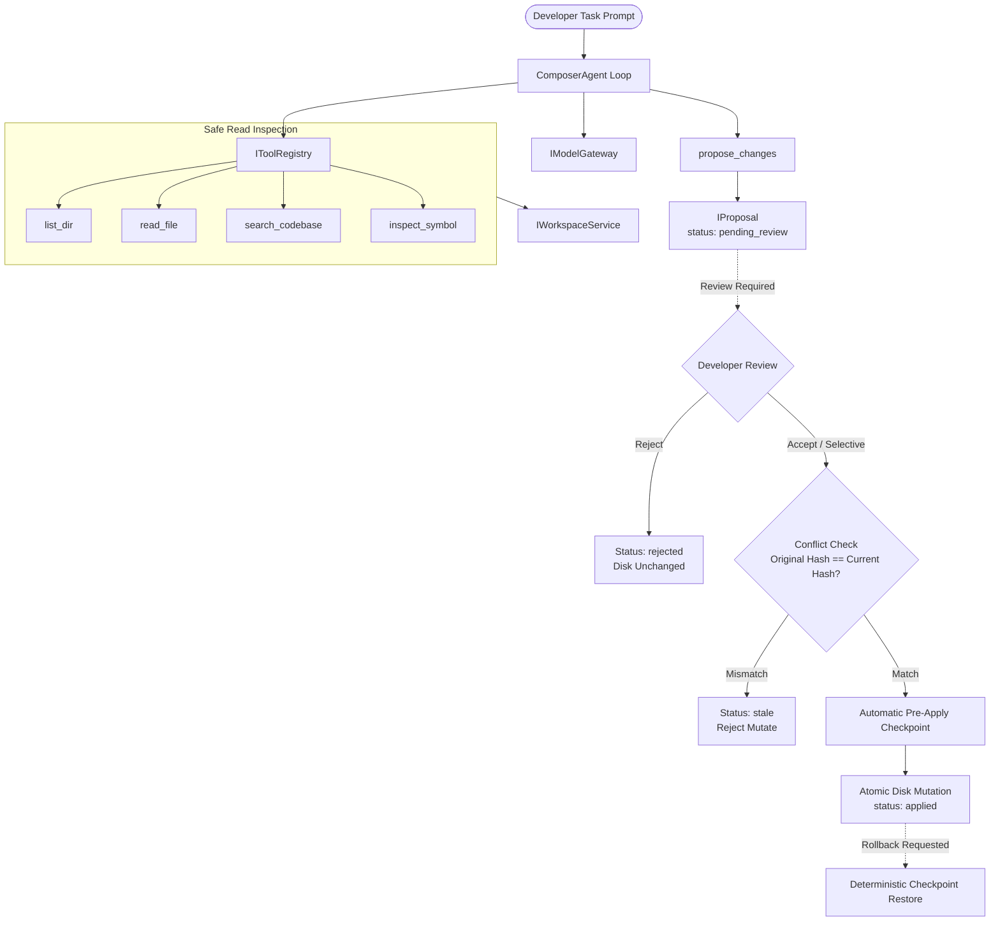

# FLOAT Recovery Phase 5: Composer and Autonomous Code Editing

## 1. Overview & Objective

Phase 5 delivers the central Cursor-style Composer and autonomous code editing engine for FLOAT Studio. It transforms AI assistance from generic conversational replies into a strictly bounded, reviewable, multi-file editing workflow.

### Core Workflow:
1. User requests a software engineering task or feature.
2. Composer Agent inspects the project using canonical tools (`list_dir`, `read_file`, `search_codebase`, `inspect_symbol`).
3. Agent analyzes dependencies and references across the codebase.
4. Agent generates an `IProposal` containing multi-file changes with unified diffs, line additions/deletions statistics, and content hashes.
5. **CRITICAL INVARIANT**: Changes remain in `pending_review` status; **no unapproved modification reaches the real workspace on disk**.
6. User reviews the multi-file diff in the workbench or Composer card.
7. User accepts, rejects, or selectively applies changes.
8. Upon acceptance:
   - System verifies baseline hash equality to detect stale conflicts.
   - System captures an automatic pre-apply safety checkpoint (`IWorkspaceCheckpoint`).
   - System atomically writes changes to workspace files.
9. If errors occur or the user requests an undo, a deterministic one-click rollback restores the workspace to the exact pre-apply state.

---

## 2. Architecture & Subsystems

### Key Components

1. **`src/services/composer/composerAgent.ts`**:
   - Manages the multi-turn agent loop.
   - Enforces execution limits: `maxIterations`, `timeoutMs`, `maxTokens`, and cancellation via `AbortSignal`.
   - Emits structured progress events (`started`, `iteration_start`, `thinking`, `tool_call`, `tool_result`, `proposal_created`, `completed`, `cancelled`, `error`).
   - Guarantees zero unapproved writes to disk.

2. **`src/services/composer/canonicalTools.ts`**:
   - `list_dir`: safe directory listing with pagination and path filtering.
   - `read_file`: safe file reading with traversal and secret exclusion checks.
   - `search_codebase`: multi-signal AST/BM25 retrieval.
   - `inspect_symbol`: definitions, references, and type inspection.
   - `propose_changes`: creates reviewable `IProposal` with `computeDiffStats` and `generateUnifiedDiff`.
   - `run_command`: sandboxed execution of approved verification commands.

3. **`src/services/composer/checkpointManager.ts`**:
   - `WorkspaceCheckpointManager` implementing `ICheckpointManager`.
   - Captures snapshots of affected workspace files before modification.
   - Restores files deterministically (including unlinking newly created files) on rollback.

4. **`src/services/composer/proposalApplier.ts`**:
   - `checkProposalConflicts`: verifies that underlying workspace files have not changed since proposal creation.
   - `applyProposal`: creates pre-apply checkpoint, atomically writes changes, updates status to `applied` or `partially_applied`.
   - `rejectProposal`: marks proposal `rejected` while leaving disk 100% untouched.
   - `rollbackProposal`: reverts workspace state from checkpoint.

---

## 3. Verification & Acceptance Criteria

| Requirement | Implementation & Verification | Status |
| :--- | :--- | :--- |
| **Tool Registry & Argument Validation** | `CanonicalToolRegistry`, schema checks via `validateToolArgs` | **PASSED (15/15 tests)** |
| **Path Traversal & Secret Confinement** | `validateSafeWorkspacePath` blocks `../`, `.env`, `.git`, certs | **PASSED** |
| **Safety Invariant (No Unapproved Writes)** | `propose_changes` drafts `IProposal` in `pending_review`; disk untouched | **PASSED** |
| **Accurate Unified Diffs & Diff Stats** | `generateUnifiedDiff`, `computeDiffStats` (additions, deletions) | **PASSED** |
| **Stale Proposal Conflict Detection** | `checkProposalConflicts` checks hash baseline prior to applying | **PASSED** |
| **Explicit Acceptance & Atomic Apply** | `applyProposal` atomically writes approved files upon review | **PASSED** |
| **Deterministic Checkpoint Rollback** | `WorkspaceCheckpointManager` restores workspace to exact pre-apply state | **PASSED** |
| **Proposal Rejection Workflow** | `rejectProposal` updates status to `rejected` with zero disk impact | **PASSED** |
| **Budget & Cancellation Enforcement** | Iteration budget, timeout budget, and `AbortSignal` cancellation verified | **PASSED** |
