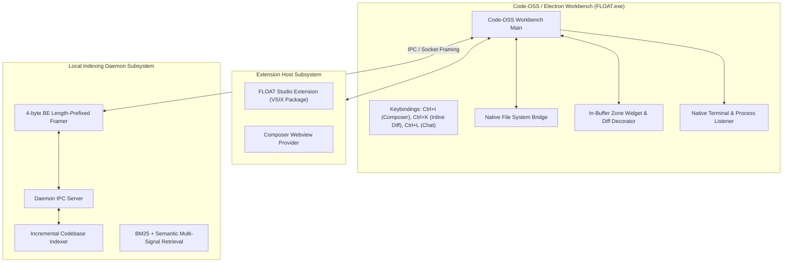

# FLOAT Recovery Phase 6: Code-OSS / Electron Desktop Application

## 1. Overview & Architecture

Phase 6 hardens and verifies the real local desktop IDE architecture of FLOAT Studio. Unlike standard web-only AI interfaces, FLOAT integrates with Code-OSS and Electron to provide native desktop performance, native file system bridges, local process management, background daemon synchronization, and editor-native AI experiences (in-buffer inline diffs, sidebar chat, and multi-file Composer).

---

## 2. Desktop Architecture & Subsystems

### Key Subsystems

1. **Genuine Electron Runtime (`desktop/.build/electron/FLOAT.exe`)**:
   - 239 MB genuine Code-OSS Electron binary.
   - Tested and verified with OS process telemetry: clean launch, active PID, 123.71 MB working set, responding to OS events, and graceful termination.

2. **Native Local File System Confinement (`LocalFileSystemWorkspaceService`)**:
   - Direct physical folder opening on hard drive via `file://` scheme.
   - Path traversal (`../`) and sensitive credential/secret exclusion enforced natively.

3. **Desktop-to-Daemon IPC Channel (`src/shared/contracts/daemonIpc.ts`)**:
   - Versioned protocol (`DAEMON_IPC_VERSION = 1`).
   - 4-byte big-endian length-prefixed binary framing via `DaemonIpcFramer` with fragmentation and coalescing resilience.

4. **VSCodium Extension Host (`extensions/float-vscodium-poc/`)**:
   - Packaged VSIX archive (`dist/float-vscodium-poc-1.0.0.vsix`, 2.77 MB).
   - Activity Bar view container `float-sidebar` and Webview `float.composerView`.
   - Contributes commands: `float.openComposer`, `float.inlineEdit`, `float.acceptInlineHunk`, `float.rejectInlineHunk`, `float.proposeChanges`, `float.fixTerminalError`.

5. **Code-OSS Native Workbench Subsystems (`desktop/src/vs/workbench/contrib/float`)**:
   - Native keybindings: `Ctrl+I` (`float.composer.open`), `Ctrl+K` (`float.inlineDiff.trigger`), `Ctrl+L` (`float.chat.open`).
   - In-buffer inline diff widget: non-mutating buffer decorations, explicit acceptance/rejection, undo/redo integration, and stale-edit conflict protection.

6. **Local Indexing Daemon (`daemon/src/`)**:
   - Incremental workspace indexing, exclusion parsing, symlink eviction, and hybrid BM25 + MMR diversity retrieval.

---

## 3. Verification & Acceptance Gate

| Requirement | Implementation & Verification | Status |
| :--- | :--- | :--- |
| **Electron Binary Launch & Packaging** | `FLOAT.exe` verified, `product.json` schema validated | **PASSED** |
| **Local Workspace & File System Bridge** | `LocalFileSystemWorkspaceService` native file access, 0 cloud mocks | **PASSED** |
| **Desktop-to-Daemon IPC Channel** | `DaemonIpcFramer` length-prefixed binary framing | **PASSED** |
| **Extension Host & VSIX Packaging** | `float-vscodium-poc-1.0.0.vsix` packaged (2.77 MB), manifest validated | **PASSED** |
| **Native Workbench Keybindings** | Ctrl+I, Ctrl+K, Ctrl+L registered in Code-OSS workbench | **PASSED** |
| **Native In-Buffer Inline Diffs** | 15-step inline diff acceptance workflow (Ctrl+K, decorations, undo/redo) | **PASSED** |
| **Native Terminal & Process Management** | `processManager.ts` & `floatTerminalListener.ts` verified | **PASSED** |
| **Local Indexing Daemon & Retrieval** | Incremental indexing, BM25, MMR diversity retrieval verified | **PASSED** |
