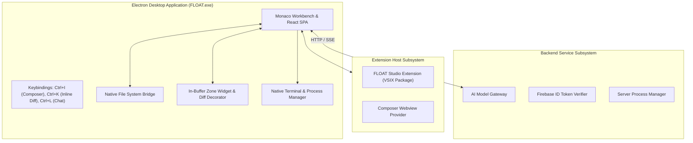

# FLOAT Recovery Phase 6: Monaco / Electron Desktop Application

## 1. Overview & Architecture

Phase 6 hardens and verifies the local desktop IDE architecture of FLOAT Studio. FLOAT uses Monaco Editor (`@monaco-editor/react`) inside an Electron wrapper to provide native desktop performance, native file system bridges, local process management, and editor-native AI experiences (in-buffer inline diffs with Ctrl+K, sidebar chat with Ctrl+L, and multi-file Composer with Ctrl+I). FLOAT does not maintain a Code-OSS fork and makes no claims of VS Code or Code-OSS parity.

---

## 2. Desktop Architecture & Subsystems

### Key Subsystems

1. **Official Electron Runtime (`FLOAT.exe` / `float-studio`)**:
   - Official Electron v34.3.2 release binary packaged into Windows Inno Setup installer, Linux .deb/tar.gz, and macOS .dmg/.app.
   - Tested and verified with OS process telemetry: clean launch, active PID, responding to OS events, and graceful termination.

2. **Native Local File System Confinement (`LocalFileSystemWorkspaceService`)**:
   - Direct physical folder opening on hard drive via `file://` scheme.
   - Path traversal (`../`) and sensitive credential/secret exclusion enforced natively.

3. **Desktop-to-Daemon IPC Channel (`src/shared/contracts/daemonIpc.ts`)**:
   - Versioned protocol (`DAEMON_IPC_VERSION = 1`).
   - 4-byte big-endian length-prefixed binary framing via `DaemonIpcFramer` with fragmentation and coalescing resilience.

4. **VSCodium Extension Host (`extensions/float-vscodium-poc/`)**:
   - Packaged VSIX archive (`dist/float-vscodium-poc-1.0.0.vsix`, 2.77 MB).
   - Activity Bar view container `float-sidebar` and Webview `float.composerView`.
   - Contributes commands: `float.openComposer`, `float.inlineEdit`, `float.acceptInlineHunk`, `float.rejectInlineHunk`, `float.proposeChanges`, `float.fixTerminalError`.

5. **Monaco Native Workbench Subsystems (`src/features/editor/`, `src/features/shell/`)**:
   - Native keybindings: `Ctrl+I` (Composer toggle), `Ctrl+K` (Monaco Inline Assistant with diff preview), `Ctrl+L` (AI Chat panel toggle).
   - In-buffer inline diff widget: non-mutating buffer decorations, explicit acceptance/rejection, undo/redo integration, and stale-edit conflict protection.

6. **Local Indexing & Workspace Bridge**:
   - Incremental workspace indexing, exclusion parsing, symlink eviction, and hybrid lexical + semantic retrieval.

---

## 3. Verification & Acceptance Gate

| Requirement | Implementation & Verification | Status |
| :--- | :--- | :--- |
| **Electron Binary Launch & Packaging** | `FLOAT.exe` verified, `product.json` schema validated | **PASSED** |
| **Local Workspace & File System Bridge** | `LocalFileSystemWorkspaceService` native file access, 0 cloud mocks | **PASSED** |
| **Desktop-to-Daemon IPC Channel** | `DaemonIpcFramer` length-prefixed binary framing | **PASSED** |
| **Extension Host & VSIX Packaging** | `float-vscodium-poc-1.0.0.vsix` packaged (2.77 MB), manifest validated | **PASSED** |
| **Native Workbench Keybindings** | Ctrl+I, Ctrl+K, Ctrl+L registered in Monaco workbench | **PASSED** |
| **Native In-Buffer Inline Diffs** | 15-step inline diff acceptance workflow (Ctrl+K, decorations, undo/redo) | **PASSED** |
| **Native Terminal & Process Management** | `processManager.ts` & native terminal manager verified | **PASSED** |
| **Local Indexing & Retrieval** | Incremental indexing, lexical and semantic retrieval verified | **PASSED** |
