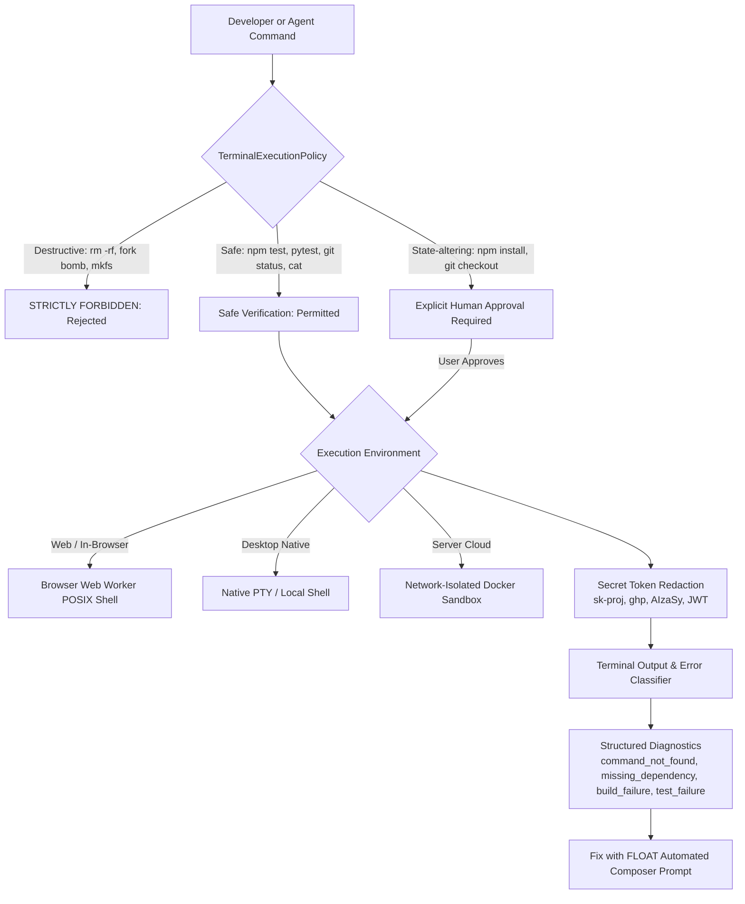

# FLOAT Recovery Phase 7: Terminal, Execution, and Verification

## 1. Overview & Objectives

Phase 7 hardens and verifies integrated terminal execution, process sandboxing, diagnostics parsing, and automated fix verification across web, server, and desktop environments.

Developers and autonomous AI agents require safe, sandboxed execution boundaries to run build tasks, linters, tests, and debugging commands without risking privilege escalation, destructive filesystem operations, or secret leakage.

---

## 2. Architecture & Subsystems



### Key Subsystems

1. **Terminal Execution Policy (`src/services/terminal/terminalExecutionPolicy.ts`)**:
   - `evaluateCommand(command)` classifies shell commands into safety tiers:
     - `dangerous`: destructive patterns (`rm -rf /`, fork bombs, `mkfs`, raw `dd`, `chmod 777 /`) are strictly blocked.
     - `verification`: test and read commands (`npm test`, `pytest`, `python -m unittest`, `git status`, `cat`) are permitted without gating.
     - `dependency_install` / `state_change`: package installations (`npm install`, `pip install`) and git repository mutations (`git checkout`, `git push`) require explicit human authorization.

2. **Terminal Diagnostics & Error Classifier (`src/services/terminal/terminalClassifier.ts`)**:
   - Analyzes standard error and non-zero exit codes to detect:
     - `command_not_found`: missing CLI tools on Windows and Unix.
     - `missing_dependency`: Node.js (`Cannot find module`) and Python (`ModuleNotFoundError`, `ImportError`).
     - `build_failure`: TypeScript compiler errors with exact source file and line locations (`error TS2304 in src/file.ts:42`).
     - `test_failure`: Jest, Vitest, and unittest assertion errors (`FAIL src/test.ts`, `AssertionError`).
     - `permission_denied`: filesystem permission issues (`EACCES`).
   - Synthesizes formatted `recommendedPrompt` for immediate Composer remediation.

3. **Secret Token Redaction (`src/server/terminal/terminalService.ts`)**:
   - `sanitizeTerminalOutput` scrubs all API keys and credentials:
     - OpenAI API keys (`sk-proj-...`, `sk-live-...`)
     - GitHub personal access tokens (`ghp_...`, `github_pat_...`)
     - Google Cloud API keys (`AIzaSy...`)
     - JWT bearer tokens
   - Replaces all detected credentials with `[REDACTED_SECRET]`.

4. **Terminal Session Manager & Confinement**:
   - Persistent sessions in `TerminalService` with bounded output buffers (32 KB window).
   - Strict path traversal prevention on working directory navigation (rejects `../`, Windows absolute paths, and null bytes).
   - Multi-tenant tenant boundaries (sessions only retrievable by verified session owners).

5. **Process Lifecycle & Cancellation**:
   - Process manager reliably captures exit codes and stdout/stderr streams.
   - `AbortSignal` integration terminates in-flight command executions cleanly.

---

## 3. Verification & Acceptance Gate

The verification suite (`scripts/testPhase7TerminalAndExecution.ts`) verified all 11 terminal and execution checks:

```
=== FLOAT Recovery Phase 7: Terminal, Execution, and Verification Test Suite ===

1. Command Execution Policy & Sandbox Boundaries
  [PASS] Permits safe test and verification commands without human approval
  [PASS] Requires explicit human approval for dependency install and git mutations
  [PASS] Strictly blocks destructive shell commands as dangerous

2. Terminal Error Classification & Diagnostics
  [PASS] Classifies command_not_found errors across Windows and Unix patterns
  [PASS] Classifies missing_dependency for Node.js and Python packages
  [PASS] Classifies TypeScript compiler build failures with exact file and line
  [PASS] Classifies test failures and assertion errors

3. Secret Token Sanitization
  [PASS] sanitizeTerminalOutput scrubs API keys and secret tokens

4. Terminal Session Security & Path Traversal
  [PASS] TerminalService enforces project isolation and blocks path traversal

5. Command Execution & Cancellation
  [PASS] run_command executes and returns stdout and exit code 0
  [PASS] run_command terminates cleanly when aborted via AbortSignal

========================================
Phase 7 Test Results: 11 passed, 0 failed
========================================
```

- `npm run lint` (`tsc --noEmit`): **0 errors**.
- All unit tests passed.
