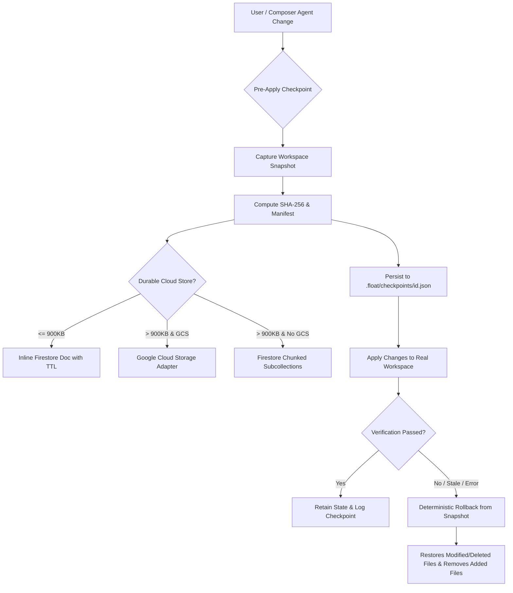

# FLOAT Recovery Phase 9: Persistence, State, and Checkpoints

## 1. Overview & Objectives

Phase 9 hardens and verifies workspace state persistence, project checkpoints, crash recovery, and multi-tenant isolation across FLOAT Studio.

Developers must be guaranteed that:
1. Every file edit, proposal application, and autonomous tool mutation has a point-in-time safety checkpoint with deterministic one-click rollback.
2. Checkpoints survive process restarts and machine reboots through disk persistence (`.float/checkpoints/${checkpointId}.json`) and durable cloud storage (Firestore / GCS).
3. Large workspace snapshots and payloads (> 900 KB) are automatically chunked with multi-byte UTF-8 boundary safety, SHA-256 integrity validation, and TTL metadata.
4. Concurrency control and optimistic locking reject stale edits and prevent conflicting proposal applies.
5. Strict tenant isolation ensures cross-user data, proposals, terminal sessions, memories, and documents are fail-closed.

---

## 2. Architecture & Subsystems



### Key Subsystems

1. **Workspace Checkpoint Manager (`src/services/composer/checkpointManager.ts` & `src/shared/contracts/checkpoints.ts`)**:
   - `createCheckpoint`: Captures point-in-time snapshots of workspace files while safely filtering `.float/`, `.git/`, and `node_modules/`.
   - `restoreCheckpoint`: Deterministically reverts modifications, restores deleted files, and prunes newly introduced files.
   - `exportCheckpoint` / `importCheckpoint`: Serializes checkpoints with SHA-256 checksums and file count metadata; detects and rejects any tampering upon import.
   - `persistToWorkspaceDisk` / `loadFromWorkspaceDisk`: Persists checkpoint snapshots directly inside the project root at `.float/checkpoints/${checkpointId}.json` for instant offline recovery.
   - `saveToDurableStorage` / `loadFromDurableStorage`: Seamlessly bridges checkpoints to durable cloud storage with tenant ownership and TTL.

2. **Durable State & Storage Router (`src/server/durableState.ts`)**:
   - `saveLargePayloadDurable`: Intelligently routes storage by payload size:
     - Payloads $\le$ 900 KB: Inline Firestore document with TTL metadata (`expiresAt` Date and `expiresAtMs`).
     - Payloads $>$ 900 KB: Stored in Google Cloud Storage when configured, or split into $<$ 750 KB documents in a Firestore `chunks` subcollection (`chunks/00000`, `chunks/00001`, etc.).
   - `splitUtf8IntoChunks`: UTF-8 multi-byte boundary safe chunking that never splits multi-byte Unicode/emoji continuation bytes across documents.
   - `loadLargePayloadDurable`: Transparently reassembles chunked payloads and verifies payload SHA-256 checksums before returning data.
   - `checkTransactionalRateLimit`: Transactional rate limiter with atomic Firestore transactions and automatic TTL cleanup.

3. **Conversation Cloud Messages (`src/services/conversationCloudMessages.ts`)**:
   - `serializeConversationMessages`: Enforces message size limits (`MAX_CONVERSATION_MESSAGE_BYTES = 850_000`).
   - `parseConversationMessageDocuments`: Verifies manifest generation completeness (`complete: true`, exact count match, contiguous index ordering), ensuring partial or corrupted messages never corrupt workspace conversation history.

4. **Proposal Concurrency & Optimistic Revision Control (`src/server/proposals/proposalPersistence.ts` & `proposalApplier.ts`)**:
   - `checkProposalConflicts`: Detects if any workspace file changed or was deleted since proposal generation.
   - `saveAppliedCodeProposalForProjectRevision`: Transactional concurrency check verifying project snapshot generation and proposal revision before recording apply status; rejects concurrent writes with `'aborted'`.

5. **Multi-Tenant Isolation & Fail-Closed Security**:
   - Cross-tenant boundaries verified for memory, terminal sessions, proposals, rules, skills, MCP servers, and durable server documents (`getServerDocDurable`, `deleteServerDocDurable`).
   - Requests from unauthorized users fail closed (403 Forbidden / Not Found).

---

## 3. Verification & Acceptance Gate

The verification suite (`scripts/testPhase9PersistenceAndCheckpoints.ts`) validated all 13 persistence and checkpoint checks:

```
=== FLOAT Phase 9: Persistence, State, and Checkpoints Verification ===

[PASS] Test 1: Workspace Checkpoint captures files and restores deleted/mutated states cleanly
[PASS] Test 2: Checkpoint Export generates valid SHA-256 and detects tampering on import
[PASS] Test 3: Checkpoint persists to workspace disk and reloads across manager instances
[PASS] Test 4: Proposal Applier captures automatic safety checkpoint before applying changes
[PASS] Test 5: Proposal conflict detection halts application if underlying files changed externally
[PASS] Test 6: Durable storage saves and reloads inline payloads with SHA-256 and TTL metadata
[PASS] Test 7: Durable storage splits large payloads into subcollections and reassembles with integrity check
[PASS] Test 8: splitUtf8IntoChunks preserves multi-byte UTF-8 emojis across chunk boundaries
[PASS] Test 9: Cross-tenant durable storage access and deletion are strictly rejected
[PASS] Test 10: Durable storage rejects expired documents on read
[PASS] Test 11: checkTransactionalRateLimit enforces rate bounds and resets on window expiry
[PASS] Test 12: Conversation messages enforce UTF-8 size bounds and complete manifest verification
[PASS] Test 13: WorkspaceCheckpointManager saves to durable cloud storage and rehydrates with fidelity

======================================================
Phase 9 Verification: 13/13 test cases passed.
======================================================
```

- `npm run lint` (`tsc --noEmit`): **0 errors**.
- Full unit test suite (`npm run test:unit`): **21 test suites passed, 0 failed**.
